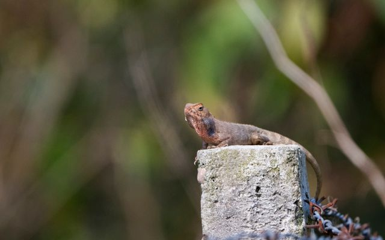

*“Rumah yang gada cicaknya”*.
ucap wanita yang telah tinggal bersamaku hampir 5 tahun lamanya, saatku bertanya rumah yang menarik untuknya yang modelnya seperti apa.
Ya, hewan yang sangat ditakuti olehnya mungkin lebih tepatnya “geli”.

Hewan yang selalu membuat kejutan yang muncul ditempat tak terduga, saat membuka pintu kamar mandi dan muncul dari balik engsel pintu yang berkarat.  

Terkadang muncul ketika ingin membuang air dari belakang kulkas dari lelehan bunga es *freezer* dari kulkas lama yang bekas almarhum nenek saya.

Hewan yang dahulu sering saya bunuh ketika masih kecil,dan sekarang saya pun malah ikut-ikutan 'geli' saat melihat dinding dirayapi oleh hewan *mimikri* satu ini.

Kata salah satu channel youtube : Alam Semenit. \
Hewan ini sering kali muncul di tempat hangat, makanya seringnya muncul di malam hari dan bersembunyi di balik pintu, di bawah kulkas, dan -yang pasti- di dapur yang kadang masih menyimpan hawa panas yang tersimpan saat memasak.

Kadang saya merasa agak phsycopat ketika memukul bahkan menggencet mereka dengan rel gordyn bekas yang tak terpakai lagi bahkan bagian ujungnya sudah penyok karena pukulan yang agak keras. 

Puas rasanya ketika hewan tersebut mulai sekarat dan ekor mereka terputus, dalam agama islam ketika berhasil membunuh hewan ini dalam sekali pukulan maka pahalanya akan sempurna, tetapi ketika gagal dan mencobanya berulangkali maka pahala berkurang di setiap pukulan sampai pada akhirnya mati. 

Ya hewan menyebalkan kedua setelah tikus yang paling sering muncul di dinding rumah kontrakan ini sungguh membuat saya berpikir apakah ada dinding yang anti 'ketempelan' cicak, jika ada sepertinya akan mahal harganya.

Sebaliknya, kalau saya melihat kecoa terbang saya panik, istri saya sama sekali tidak.

Ya istri justru berani dengan kecoa, saya heran ketika hewan yang bentuknya seperti kurma ini terbang ke bawah pakaian yang dia gunakan, dan dia biasa aja. Beda dengan saya yang was-was.

Ketika hewan ini muncul biasanya saya langsung mencari sapu lidi yang fungsinya selain buat menebah kasur kadang buat pukul kecoa juga.

Harus dengan tenaga yang pas ketika memukul, kalau pelan ya akan kabur lagi, tapi kalau terlampau keras malah jadi kaya kecoa ‘moncrot’ yang isi perutnya keluar.

Rmah yang nyaman itu rumah yang jauh dan minim hewan hewan yang kita takuti.

Bayangkan rumah bagus tetapi banyak cicak atau kecoanya, ohh ngga banget kan. 😅
